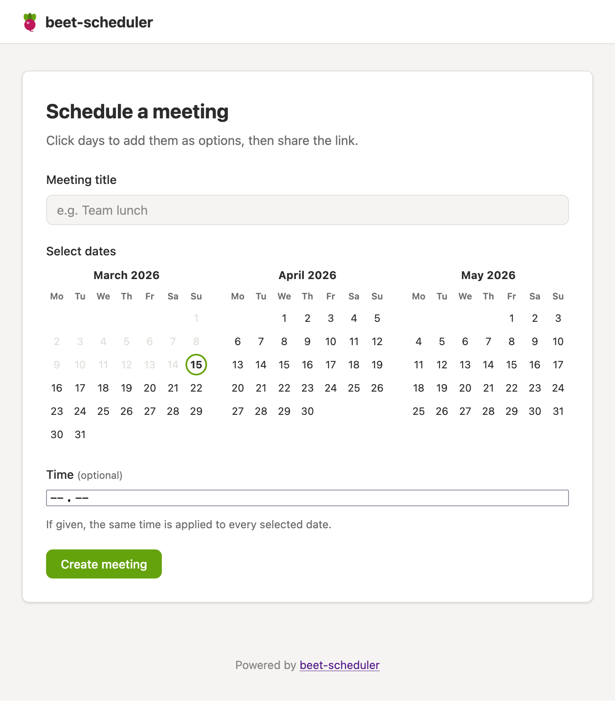

<!--
SPDX-FileCopyrightText: 2026 Miikka Koskinen

SPDX-License-Identifier: MIT
-->

# beet-scheduler

Vibecoded site for scheduling polls.



## Running it locally

```bash
just run
```

## Configuration

Configuration is loaded from `beet-scheduler.toml` (optional) and environment variables prefixed with `BEET_`.

| Key | Env var | Default | Description |
|-----|---------|---------|-------------|
| `html_snippet` | `BEET_HTML_SNIPPET` | _(empty)_ | Raw HTML injected into every page, e.g. an analytics script. |
| `write_rate_limit_per_minute` | `BEET_WRITE_RATE_LIMIT_PER_MINUTE` | `30` | Maximum POST requests per client (IPv4 address or IPv6 /64) per minute. `0` disables the limit. |
| `trust_forwarded_for` | `BEET_TRUST_FORWARDED_FOR` | `false` | Identify clients by the last `X-Forwarded-For` entry. Enable only behind a reverse proxy that sets this header; otherwise clients can spoof it. |
| `max_db_size_mb` | `BEET_MAX_DB_SIZE_MB` | `1024` | Maximum SQLite database size. Writes fail with 503 once it is reached. |
| `retention_days` | `BEET_RETENTION_DAYS` | `90` | Delete meetings this many days after they were created or after their last time slot, whichever is later. Checked hourly. `0` keeps meetings forever. |

Example `beet-scheduler.toml`:

```toml
html_snippet = '<script defer src="https://example.com/analytics.js"></script>'
```
